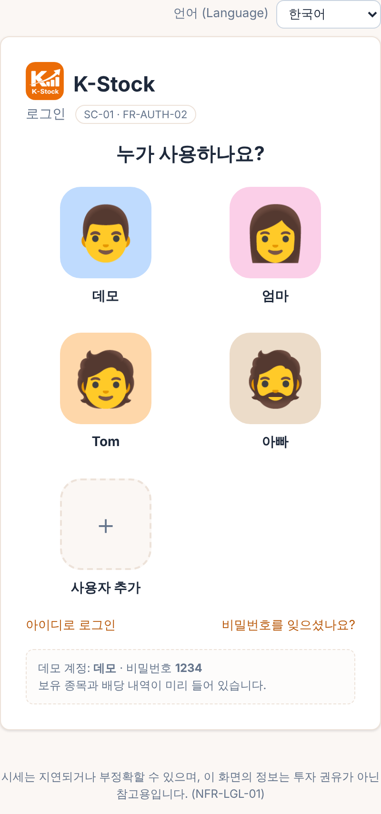
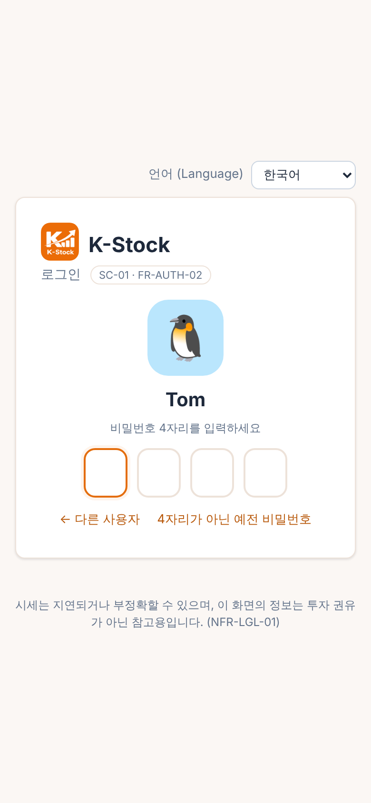
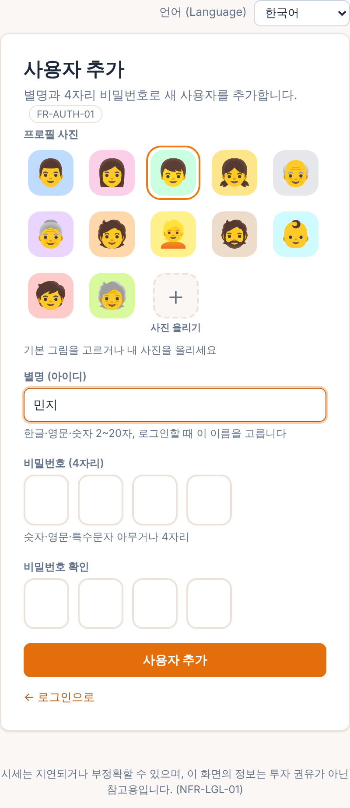
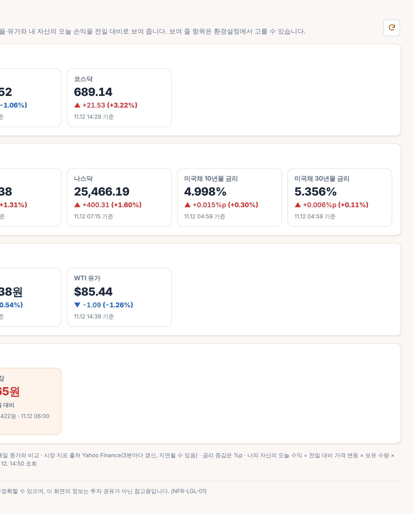
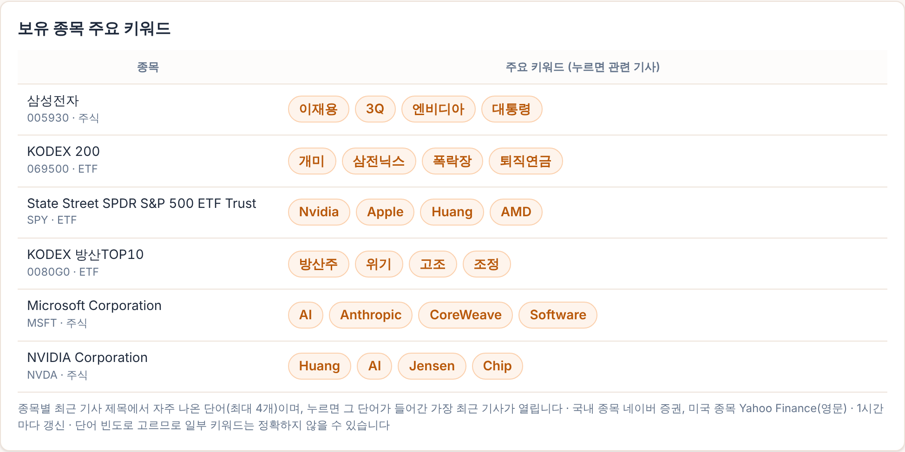
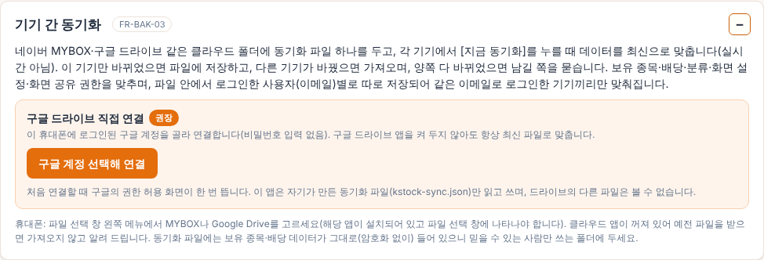
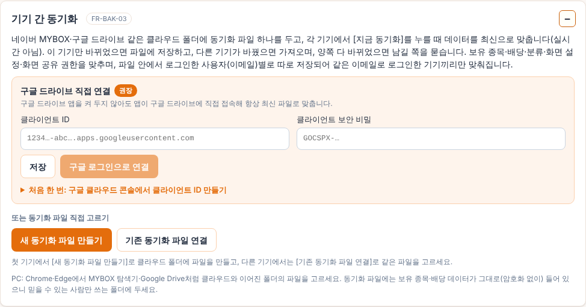

# K-Stock (주식 관리시스템 프로토타입)

「주식 관리시스템 요구사항 정의서」를 정확히 이해했는지 확인받기 위한 동작 프로토타입입니다. 프로토타입 검토 결과를 반영한 **최종본은 `docs/requirements/주식관리시스템_요구사항정의서_v1.4_최종.pdf`**(프로토타입 v0.30.57 반영, 원본 HTML: `docs/requirements/source/requirements_v1.4.html`, 이전 판 v1.0~v1.3도 함께 보관)입니다.
Front(HTML/JS + Chart.js), Back(Node.js + Express), DB(SQLite)로 구성했고, 실제 시세(야후 파이낸스, 네이버 증권)를 가져옵니다.
PC(Windows)에서 실행하는 웹 버전과, 휴대폰에 설치하는 **안드로이드 앱(APK)** 두 가지로 제공합니다.

## 실행 방법 (Windows)

1. **Node.js 18 이상**이 필요합니다. 없으면 <https://nodejs.org>에서 LTS 버전을 설치합니다.
2. `stock-prototype` 폴더의 **`start.bat`을 더블클릭**합니다.
   - 처음 한 번은 패키지를 설치합니다(1~2분, 인터넷 필요).
   - 서버가 뜨면 **Chrome이 자동으로 `http://localhost:3000`을 엽니다**(Chrome이 없으면 기본 브라우저).
3. 로그인 화면의 **데모** 프로필을 누르고 비밀번호 **`1234`**를 입력합니다(아이디로 로그인할 때는 `demo@example.com`)
   (보유 종목과 배당 입력 회차가 미리 들어 있습니다 — 배당 회차는 처음 실행할 때 인터넷에서 실제 배당 내역을 받아 채웁니다. 새로 가입해도 됩니다.)
4. 종료하려면 검은 창에서 `Ctrl + C`를 누르거나 창을 닫습니다.

명령 프롬프트로 직접 실행하려면:

```bash
npm install
```

```bash
npm start
```

- 인터넷이 안 되는 곳에서 시연할 때는 **`start-sample.bat`**을 실행합니다. 가상 시세로 동작하며(포트 3001), 출처 연동부만 바꿔 끼워도 나머지 기능이 그대로 동작함을 보여줍니다(FR-DATA-07).
- 데이터를 처음 상태로 되돌리려면 서버를 끄고 `data` 폴더를 지운 뒤 다시 실행합니다.

## 안드로이드 앱 (APK)

- 설치 파일: **`release/stock-manager-v0.30.57.apk`** (Android 6.0 이상)
- 휴대폰으로 파일을 옮겨 실행하면 설치됩니다. 처음 설치할 때 "출처를 알 수 없는 앱 설치"를 허용해야 하며, Play 프로텍트 경고가 나오면 "무시하고 설치"를 선택합니다.
- 서버 없이 앱 혼자 동작합니다. PC 버전의 서버 코드(`server/`)를 그대로 묶어 앱 안에서 실행하고, 시세는 앱이 야후·네이버에서 직접 가져오며, DB는 휴대폰 안에 저장합니다. 화면 코드(`public/`)도 PC와 같습니다.
- 샘플 계정(**샘플** / `1234`, v0.30.27 전에는 ‘데모’)이 들어 있고, 엑셀 내보내기 파일은 휴대폰의 **다운로드** 폴더에 저장됩니다.
- 앱 버전은 회원 데이터가 **휴대폰마다 따로** 저장됩니다. 여러 회원이 같은 데이터를 공유하는 서버 구조는 PC 웹 버전으로 시연하세요.
- **데이터 백업·복원(v0.15)**: **환경설정 → 백업 파일 저장**을 누르면 안드로이드 파일 선택 창이 열리고, 고른 위치(다운로드 폴더·구글 드라이브 등)에 `stock-manager-backup-날짜.json`이 저장됩니다. 이 위치는 앱을 지워도 남습니다. 앱을 다시 설치한 뒤에는 회원가입(또는 로그인) → **환경설정 → 백업 파일로 복원** → 저장해 둔 파일을 고르면 그룹·연도별 주식 항목(이월 금액·수량 포함)·종목 분류·배당내역 관리 회차·화면 설정이 그대로 돌아옵니다. 복원하면 지금 계정의 데이터는 백업 내용으로 모두 바뀝니다. PC 웹 버전도 같은 파일로 백업·복원할 수 있어 PC ↔ 휴대폰 간 데이터 옮기기에도 쓸 수 있습니다.

다시 빌드하려면 (Ubuntu/Debian):

```bash
sudo apt-get install android-sdk-platform-23 aapt apksigner zipalign dalvik-exchange openjdk-17-jdk
```

```bash
npm install && ./android/build.sh
```

결과물은 `dist/stock-manager.apk`입니다. 처음 빌드할 때 `~/.android/stock-manager.keystore` 서명 키가 만들어지며, 같은 키로 서명해야 기존 앱 위에 업데이트 설치가 됩니다.

## 화면 공유 · 권한 관리 (v0.16)

내 화면 중 일부만 골라 다른 회원에게 보여줄 수 있습니다.

1. 공유하는 사람: **환경설정 → 화면 공유 · 권한 관리**에서 상대방 이메일(먼저 회원가입되어 있어야 함)을 넣고 화면마다 권한을 고른 뒤 **공유 추가**를 누릅니다.
   - 공유할 수 있는 화면: 연도별 자산·자산 현황·종목 조회(조회), 보유 종목 관리·배당내역 관리(조회 또는 편집)
   - 종목 조회(v0.17 추가)의 ‘내 보유 종목’ 목록은 공유한 회원 기준이며, 보유 종목 관리 편집 권한이 없으면 ‘보유 종목으로 등록’ 버튼이 숨겨집니다.
   - 환경설정(백업·비밀번호·탈퇴·테마)은 공유되지 않습니다.
   - 목록에서 권한을 바로 바꿀 수 있고, 모두 ‘없음’으로 바꾸거나 휴지통을 누르면 공유가 해제됩니다.
2. 공유받는 사람: 메뉴 위 **보는 자산**에서 공유한 사람을 고르면 허용된 화면만 메뉴에 나오고, 화면 위에 ‘○○님이 공유한 화면 · 조회 전용/편집 가능’ 안내가 붙습니다. **내 자산으로 돌아가기**로 언제든 돌아옵니다.
   - 조회 권한이면 등록 폼·수정·삭제·그룹 관리·일괄이월·회차 저장 버튼이 숨겨지고, 서버에서도 쓰기 요청을 막습니다(엑셀 내보내기는 가능).
   - 공유받은 화면에서 바꾼 연도·그룹 선택은 내 화면 설정에 저장되지 않습니다.
3. 권한 검사는 서버에서 합니다. 요청에 붙은 `as=<공유한 회원 id>`를 보고, 요청 경로가 어느 화면에 속하는지와 그 화면 권한(view/edit)을 확인한 뒤에만 공유한 회원의 데이터로 처리합니다(`screen_shares` 표).
4. 안드로이드 앱은 데이터가 휴대폰 안에 있으므로 같은 휴대폰의 다른 계정끼리만 공유됩니다. 여러 사람이 함께 쓰려면 PC 웹 버전 서버를 사용하세요.

## 화면 테마 (v0.17)

- **환경설정 → 화면 테마**에서 기준 색을 고르면 전체 화면 색이 바뀝니다. 준비된 색 10가지(주황(기본)·빨강·핑크·보라·남색·파랑·청록·초록·황토·회색) 중에서 고르거나, **직접 지정**(색 선택기 또는 `#RRGGBB` 입력 → 적용)으로 원하는 색을 쓸 수 있습니다. **기본값(주황)으로**를 누르면 처음 색으로 돌아갑니다.
- 기준 색 하나에서 왼쪽 메뉴·모바일 상단 그라데이션, 기본 버튼·탭·링크, 그룹 제목·합계 행, 입력칸 테두리, 배경·테두리 색을 자동으로 계산합니다(CSS 변수 `--primary`, `--t-50`~`--t-900`, `--side-a/b/c` 등). 너무 밝은 색은 흰 글자가 읽히도록 자동으로 조금 진하게 맞춥니다.
- 테마는 계정 설정(`ui.theme`)에 저장되어 PC·앱 어디서나 같게 보이고, 백업 파일에도 함께 담깁니다. 로그인 화면은 그 기기에서 마지막으로 쓴 테마로 보입니다.
- **그래프 색도 테마를 따릅니다(v0.19)**: 연도별 자산 증감(국내·해외·해외추종 막대)과 연도별 배당 증감(배당·과세표준액·세금 막대)은 테마 기준 색 한 계열에서 **조금 진하게 · 기본 · 조금 연하게** 3단계로 칠하고, 환율 꺾은선은 같은 계열의 아주 진한 색으로 그려 색 컨셉이 흐트러지지 않게 했습니다. 테마 카드의 미리보기에서 그래프 색을 확인할 수 있습니다.
- 상승 빨강·하락 파랑(종목 시세 그래프 포함)과 분류 배지 색은 의미가 있는 색이라 테마와 관계없이 그대로입니다. 공유받은 화면을 볼 때도 내 테마가 적용됩니다.
- 왼쪽 메뉴(모바일 상단 메뉴 포함) 글자는 한 단계 크고 굵게 표시합니다(v0.18).

## 언어 선택 · 종목 바로가기 상자 (v0.26)

- **언어(Language)**: 로그인 화면 위쪽과 환경설정 → 언어에서 **한국어 / English** 를 고릅니다. 고른 언어는 이 기기에 기억하고, 로그인 중이면 계정에도 저장해 다른 기기에서도 같은 언어로 보입니다. 로그인 화면에서 고른 언어는 로그인 후에도 그대로 쓰이고 계정에 저장됩니다.
  - 동작 방식: 화면 코드는 한국어 그대로 두고, 영어를 고르면 `public/i18n.js` 가 화면에 그려지는 글자·입력칸 안내·툴팁·확인 창·서버 오류 메시지를 사전(`public/i18n/en.js`, 약 670개 문구)과 숫자 단위 규칙(원→₩, 2026년→2026, 11월→Nov, 3개·5건 등)으로 바꿉니다. 그래프 글자(범례·툴팁·축)는 코드에서 직접 바꿉니다.
  - 그대로 두는 것(v0.26.1): **사용자가 직접 입력한 내용**(그룹 이름 — 기본 그룹 ‘일반·연금’ 포함, 메모)과 종목명, 엑셀 파일 내용. 화면 코드에서 이런 값은 `ud()` 로 감싸 `data-noi18n` 표시를 붙이며, 번역기는 그 안을 건드리지 않습니다.
  - 새 문구를 추가하면 `public/i18n/en.js` 에 영어를 함께 넣어야 영어 화면에 반영됩니다.
- **종목 조회 바로가기 상자**: ‘내 보유 종목’·‘내가 조회한 종목’ 상자를 종목을 조회한 뒤에도 그대로 보여 주고(조회 중인 종목은 강조), 각 상자 오른쪽 위 −/+ 로 접고 펼 수 있습니다(접은 상태 기억). 보유하지 않은 종목을 조회하면 ‘내가 조회한 종목’ 상자가 바로 갱신됩니다.

## 표 열 숨기기 · 종목 열 폭 · 처음 접힌 상자 (v0.26.10)

- **열 선택**: 모든 메뉴에서 열이 4개 이상인 표 위의 **⋮ 열 선택**을 눌러 보고 싶은 열만 체크(첫 열은 항상 보임, 모두 보기로 되돌림). 화면·상자·표 위치·열 수별로 계정에 저장(동기화·백업에도 포함). 그룹 행·소계 행처럼 여러 칸을 합친 줄도 숨긴 열만큼 자동으로 맞춤
- **종목 열**: 원래 폭의 80%로 줄이고, 종목명이 길어 넘치면 글자 크기를 자동으로 줄여 모두 보이게 함(배지가 있는 둘째 줄은 최소 크기에서도 넘치면 줄바꿈)
- **처음 열 때 접힌 상자**: 보유 종목 관리의 **종목 등록**, 환경설정의 **모든 상자**. 접기/펴기를 한 번 누르면 그 뒤로는 사용자가 정한 상태를 유지. 종목 조회의 ‘보유 종목으로 등록’이나 목록의 수정으로 들어오면 종목 등록 상자를 자동으로 폄
- (v0.26.11) 열 선택 버튼과 표를 한 묶음으로 감싸 연도별 자산 증감·연도별 배당 증감에서 표가 다시 그래프 옆에 놓임. 종목 조회 화면·팝업의 **분기 실적·연간 실적** 상자도 처음엔 접힘(상자마다 한 번만 적용되므로 이미 쓰던 화면에 새로 생긴 상자에도 적용). 종목 조회 팝업의 연간 실적–날짜별 종가 상자 간격을 다른 상자와 같게(16px)
- (v0.26.12) 연도별 배당 증감 상자 맨 아래 주석을 표 칸이 아닌 상자 전체 폭(그래프 영역부터)으로, 연도별 자산 증감과 같게
- (v0.26.14) **기준 연도** 선택을 그룹 선택 상자 왼쪽으로 이동(라벨은 상자 제목과 같은 17px·굵게): 나의 자산 “기준 연도 [선택] [⟳ 새로고침 아이콘 버튼] | 그룹 탭”, 보유 종목 관리 “기준 연도 [선택] | 그룹 탭”(기존 ‘관리 연도’), 배당 관리 “기준 연도 [선택] | 월 [선택] ~ [선택] | 그룹 탭”(기존 ‘연도’·‘시작 월 ~ 종료 월’), 연도별 자산 · 배당 “기준 연도 [선택] ~ [선택] [조회]”(기존 ‘시작 연도 ~ 종료 연도’). 휴대폰에서는 줄바꿈되어 차례로 쌓임
- **불러오는 중 아이콘**(v0.26.11): ‘불러오는 중…’·‘조회 중…’·‘계산하는 중…’ 같은 안내가 보이는 동안 돌아가는 아이콘을 함께 표시(화면 본문·팝업·알림)
- **상자 간격**: 두 칸으로 나란히 놓인 상자(환경설정의 비밀번호 변경·사용자 삭제)가 휴대폰 세로 화면에서 위아래로 쌓일 때도 다른 상자와 같은 간격(16px)

## 별명·프로필 사진 로그인 (v0.30.0)

넷플릭스처럼 로그인 화면에 **사용자 프로필(사진 + 별명)**이 나오고, 누르면 **4자리 비밀번호**를 칸 4개에 입력합니다.

| 누가 사용하나요? | 4자리 비밀번호 | 사용자 추가 |
|---|---|---|
|  |  |  |

- **사용자 추가**: 별명(한글·영문·숫자 2~20자, 이것이 아이디) + 프로필 사진(사람 모양 기본 그림 12개(v0.30.1) 중 선택 또는 내 사진 올리기 — 가운데를 잘라 160×160으로 줄여 저장) + 비밀번호 4자리(글자 종류 제한 없음, 공백만 불가)와 확인
- **4자리 칸**: 한 글자씩 입력하면 다음 칸으로, 지우면 앞 칸으로, 붙여넣기 가능, 4자리를 다 넣으면 바로 로그인. 틀리면 칸이 흔들리고 비워짐(같은 아이디로 15분에 5번까지)
- **예전 계정**(이메일 아이디·긴 비밀번호): 그대로 쓸 수 있음. 프로필을 누른 뒤 ‘4자리가 아닌 예전 비밀번호’, 또는 ‘아이디로 로그인’. 환경설정에서 4자리 비밀번호로 바꾸면 이후 칸 4개로 로그인
- 데모 계정은 별명 ‘데모’, 비밀번호 `1234`로 바뀜(아이디는 그대로 `demo@example.com`)
- 환경설정: **프로필 사진** 바꾸기, 비밀번호 변경도 4자리 칸. 왼쪽 메뉴 아래에 사진 + 별명 표시
- 화면 공유: 공유할 사용자를 별명(또는 아이디)으로 입력
- **공개 클라우드 서버**(`CLOUD` 모드)에서는 다른 사람에게 사용자 목록이 보이지 않도록 프로필 목록 대신 아이디 입력 화면
- 보안 참고: 4자리 비밀번호는 짧으므로 휴대폰·개인 PC처럼 본인 기기에서 쓰는 것을 전제로 함

## 홈 대시보드 (v0.28.0, SC-09)

K-Stock 이름 옆 **집 모양 아이콘(홈)**을 누르면 대시보드가 열립니다.



- 항목(모두 전일 대비 증감·증감률 함께 표시)
  - 국내: 코스피(^KS11), 코스닥(^KQ11)
  - 미국: S&P 500(^GSPC), 나스닥(^IXIC), 미국채 10년물 금리(^TNX), 미국채 30년물 금리(^TYX) — 금리 증감은 %p
  - 기타: 원/달러 환율(KRW=X), WTI 유가(CL=F), **한국·미국 증시 개장 상태**(v0.28.2: 개장 중 / 개장 전 / 장 마감 / 휴장·휴장(주말), 정규장 시간 한국 시간으로 표시 — KRX 09:00~15:30, NYSE·NASDAQ 현지 09:30~16:00(한국 23:30~06:00, 서머타임엔 22:30~05:00 자동). 휴장 판단: 주말이거나, 그날 거래가 없고 거래소가 알려 주는 다음 정규장이 다른 날이면 휴장)
  - **금시세(1돈)**(v0.30.6, 기타 묶음): 국제 금값(COMEX 금 선물 GC=F, 달러/트로이온스) × 원/달러 ÷ 31.1035g × 3.75g. 국내 금 소매가(부가세·수수료 포함)와는 차이가 있음
  - 나의 자산: 오늘 수익 증감(나의 자산 화면의 ‘오늘 손익’ 합계와 같은 계산), 연간 수익 증감(금년 손익·금년 수익률, 손익 기준액 대비)(v0.28.1), 총 자산(전일 대비 증감, 매입금액 함께)(v0.28.1)
- **투자 지역·분류별 합계·나의 자산 배당 주기**(v0.30.57): 보유 종목 등록의 "분류"(국내·해외·해외추종)를 "투자 지역"으로 이름 변경. 나의 자산 조회의 분류별 합계는 종목 종류(주식·ETF·ETN)별로 바꾸고 그 아래에 투자 지역별 합계(국내·해외·해외추종)를 추가(엑셀 내보내기에도 두 합계). 나의 자산 조회의 종목별 평가금액에도 배당 주기 배지 표시
- **월배당 아이콘 강조**(v0.30.56): 월배당 배지를 붉은 계열(굵게)로 강조, 배당 중단? 배지는 구분되게 회색 점선으로
- **배당 주기 아이콘**(v0.30.55): 보유 종목 등록에서 종목을 확인하면 배당 주기를 자동으로 불러와 종목명 옆에 배지로 표시(월배당·분기배당·반기배당·연배당·무배당·배당 중단?), 주식 항목 목록에도 표시. 최근 3년 배당락일 간격의 중앙값으로 판단(배당 지급내역은 1일 재사용, 목록에서 아직 모르는 종목은 뒤에서 불러 두었다가 다음에 표시)
- **나의 배당 조회 그래프·조회 조건**(v0.30.54): 월별 배당 그래프를 연도별 자산 증감과 같은 모양으로 — 한 막대에 국내·해외·해외추종 배당을 층으로 쌓고 과세표준은 꺾은선(값 표시). 조회 조건을 배당 내역 입력과 같게 — 기준 연도 · 월(시작~끝) · 그룹 탭(전체·그룹별), 마지막 조건 기억
- **나의 배당 조회 화면 구성**(v0.30.53): 나의 자산 조회처럼 위에서부터 조회 조건(시작일·종료일·종목코드, 마지막 조건 기억) → 요약(월 배당·월 과세표준·월 세금 = 조회 기간의 마지막 달, 누적 배당·누적 과세표준·누적 세금 = 조회 기간 전체, 세금 = 과세표준 × 15.4%) → 월별 배당 그래프(기간의 달마다 막대 하나, 막대 = 월 배당, 막대 안의 진한 부분 = 그 달 과세표준) → 배당 내역 상세 표(그룹 배지, 원화 합계)
- **나의 배당 조회 메뉴·연도별 배당 상세**(v0.30.52): 나의 자산 조회 아래에 "나의 배당 조회" 메뉴 추가 — 연도별 자산 · 배당 조회에 있던 배당 내역 조회(지급일 기간·종목으로 조회)를 이 화면으로 옮김(공유는 연도별 자산 · 배당 조회 권한을 따름). 연도별 자산 · 배당 조회의 연도별 배당 증감에서 연도(표의 행 또는 그래프 막대)를 누르면 아래에 그 해 배당 내역(배당락일·지급일·종목·그룹·수량·주당배당·배당·과세표준·세금, 합계)을 표시, 다시 누르면 닫힘. 연도별 자산 증감도 그래프 막대를 누르면 종목별 내역 표시
- **메뉴 이름**(v0.30.51): "배당 입력" → "배당 내역 입력"(화면 제목·공유 권한 칸·안내 문구 포함)
- **메뉴 구분선·이름**(v0.30.50): 나의 자산 조회 아래에도 구분선(메뉴 묶음: 종목 조회 | 연도별 자산 · 배당 조회·나의 자산 조회 | 보유 종목 등록·배당 입력 | 환경 설정). "보유 종목 등록(변경)" → "보유 종목 등록"(화면 제목·공유 권한 칸·안내 문구 포함)
- **비밀번호 창 닫은 뒤 화면 위치 유지**(v0.30.49): 환경 설정에서 동기화 비밀번호 변경 등 비밀번호 입력 창을 닫은 뒤 화면이 맨 아래 쪽으로 내려가던 문제 수정(창을 열기 전 위치 그대로)
- **동기화 비밀번호 6자리·앱 로그인 유지 방식**(v0.30.48): 동기화 파일 암호화 비밀번호를 4자리에서 6자리로 — 예전 4자리 파일은 4자리로 열고, 다음에 저장할 때 6자리 새 비밀번호를 정함(다른 기기는 다음 동기화 때 6자리 입력). 백업 파일 비밀번호는 4자리 그대로. 휴대폰 앱의 로그인 정보를 앱이 켜져 있는 동안만 보관(앱을 종료하면 사라져 다시 켜면 비밀번호 입력, v0.30.47의 "실행할 때마다 로그인 화면"을 앱 쪽에서 한 번 더 보장)
- **실행할 때마다 로그인 화면**(v0.30.47): 앱(또는 브라우저 탭)을 새로 켜면 지난번 로그인 상태를 이어 쓰지 않고 항상 로그인 사용자 선택 화면부터 보여 줌(같은 실행 안에서 화면을 다시 불러올 때는 로그인 유지)
- **샘플 계정 배당 내역**(v0.30.47): 처음 설치할 때 샘플 계정의 보유 종목(일반·ISA·연금)마다 시세 출처에서 실제 배당 내역(배당락일·주당 배당금·과세표준·지급일)을 받아, 보유한 연도의 회차를 그 해 말 보유 수량으로 배당 입력에 저장해 둠 → 배당 입력·연도별 배당 증감·배당 내역 조회에 바로 나타남. 인터넷이 안 되면 1시간 뒤나 다음 실행 때 다시 시도하며, 한 번 채운 종목은 다시 건드리지 않음. 예전의 쓰이지 않던 샘플 배당 6건(옛 배당 표)은 넣지 않음
- **구글 드라이브 K-Stock 폴더**(v0.30.46): 동기화 파일을 내 드라이브의 K-Stock 폴더 안에 저장(폴더가 없으면 자동으로 만듦). 예전 버전이 내 드라이브 맨 위에 만든 동기화 파일은 다음 동기화 때 K-Stock 폴더로 옮김
- **금리 그래프 축**(v0.30.45): 대시보드 미국채 10년물·30년물 상세 그래프 왼쪽 축 숫자를 소수 둘째 자리까지(예: 4.12%)
- **요구사항 ID 숨은 스위치**(v0.30.44): K-Stock 아이콘(메뉴·휴대폰 위쪽·로그인 화면)을 2초 안에 4번 연이어 누르면 "요구사항 ID 표시" 켬·끔 창이 뜸. 기본은 숨김, 켜면 계정에 저장되어 PC·앱 어디서나 같게 적용(로그인 화면은 이 기기에 기억)
- **비밀번호 입력창 버튼 정리**(v0.30.43): 동기화·백업 비밀번호 입력창의 [취소]·[확인] 버튼 삭제(4자리를 다 넣으면 바로 진행, 닫으려면 ✕)
- **동기화·백업 파일 암호화**(v0.30.42): 동기화 파일과 백업 파일을 JSON 대신 암호화한 바이너리로 저장(AES-256-GCM, 4자리 비밀번호 → PBKDF2-SHA256 600,000번, gzip 압축). 동기화 파일은 kstock-sync.kst — 처음 동기화할 때 4자리 동기화 비밀번호를 정하고(두 번 입력) 다른 기기에서는 한 번 입력, 기기에 기억. 비밀번호가 맞지 않으면 다시 물음, 환경 설정 → 데이터 동기화의 [동기화 비밀번호 변경]으로 바꿈. 예전 kstock-sync.json은 읽어서 첫 동기화 때 암호화 파일로 바꾸고 구글 드라이브의 예전 파일은 지움. 백업 파일은 .ksb — 백업할 때마다 4자리 비밀번호를 정하고 복원할 때 입력(예전 .json 백업도 복원 가능). 비밀번호를 잊으면 파일을 열 수 없음
- **휴대폰 앱 사진 올리기 수정**(v0.30.41): 안드로이드 앱 화면에 파일 선택 창 열기 기능이 없어 환경 설정·사용자 추가의 [사진 올리기]가 반응하지 않던 문제 수정(누르면 사진 선택 창이 열림)
- **메모 칸 폭**(v0.30.40): 보유 종목 등록(변경)의 주식 항목 표에서 메모 칸 폭을 30% 줄임(긴 메모는 줄바꿈)
- **배당 내역 조회 그룹 배지**(v0.30.39): 연도별 자산 · 배당 조회의 배당 내역 조회 표에서 종목 아래 그룹 이름(일반·ISA·연금 등)을 테마 색 배지로 표시
- **휴대폰 앱 종목명 언어 수정**(v0.30.38): 휴대폰 앱에서는 화면 언어 정보가 앱 안의 서버로 전달되지 않아 English에서도 한글 종목명(예: 애플)으로 나오고 등록되던 문제 수정. 영문명을 아직 모르는 종목은 이 기기에 저장된 영문 종목명을 바로 사용
- **종목명 언어·All**(v0.30.37): 화면 언어에 맞춰 종목명을 보여 줌 — 한국어는 한글명(국내 종목 네이버 이름, 미국 종목도 네이버의 한글명이 있으면 예: 애플), English는 영문명(미국 종목 야후 이름, 국내 종목도 야후 영문명 예: Samsung Electronics Co., Ltd.). 종목 조회·종목 등록 검색 목록과 보유 종목·자산 등 모든 화면에 적용(종목마다 한글명·영문명을 저장해 두고, 모르는 이름은 처음 쓸 때 한 번 찾아 둠, 못 찾으면 원래 이름). 영어 화면에서 영문 검색어는 야후 검색을 먼저. 영어 화면의 "전체 그룹" → "All"
- **메뉴 이름·구분선**(v0.30.36): "환경설정" → "환경 설정"(안내 문구 포함), "연도별 자산 · 배당" → "연도별 자산 · 배당 조회", "나의 자산" → "나의 자산 조회"(메뉴·화면 제목·공유 권한 칸). 환경 설정 메뉴 위에도 종목 조회 아래와 같은 구분선
- **메뉴 이름**(v0.30.35): "보유 종목 등록 · 수정" → "보유 종목 등록(변경)", "배당 관리" → "배당 입력"(영어는 Dividend Entry). 화면 제목·공유 권한 칸·안내 문구도 같이 바꿈
- **메뉴 순서·이름**(v0.30.34): 왼쪽 메뉴 순서를 종목 조회 · (가로줄) · 연도별 자산 · 배당 · 나의 자산 · 보유 종목 등록 · 수정 · 배당 관리 · 환경설정으로. "보유 종목 관리"를 "보유 종목 등록 · 수정"으로 이름 변경(화면 제목·공유 화면 이름·안내 문구 포함)
- **영어 화면 점검·메뉴 순서·종목 조회 공유 제외**(v0.30.33): 영어(English)를 골랐을 때 환경설정에 한글이 남거나 단어만 섞여 번역되던 문장(동기화·구글 드라이브 설정 안내·화면 공유·백업 안내·대시보드 키워드)과 대시보드 아래 안내를 문장 통째로 영어로, 권한 이름 조회→View(검색으로 잘못 번역되던 것), "전체 그룹"→"All Group". 왼쪽 메뉴에서 종목 조회를 맨 위로 옮기고 아래에 가로줄(휴대폰 위쪽 메뉴는 세로줄). 종목 조회는 화면 공유 대상에서 빠지고(기존 공유의 종목 조회 권한은 사라짐), 공유받은 화면을 보는 중에도 환경설정처럼 내 메뉴로 열림(내 보유 종목 기준)
- **데이터 동기화 설명 문구**(v0.30.32): 데이터 동기화 상자 맨 위 설명을 구글 드라이브 연결 기준으로 바꿈(사용자 정보도 맞춘다는 내용 포함)
- **데이터 동기화 정리**(v0.30.31): 구글 드라이브 연결을 쓸 수 있는 기기에서는 "또는 동기화 파일 직접 고르기"(새 동기화 파일 만들기·기존 파일 연결)와 상자 아래 안내 문구를 없앰(이미 파일을 연결해 둔 사용자는 그 파일로 동기화·연결 해제만 가능). 구글 드라이브에 연결된 뒤 "구글 드라이브 직접 연결" 앞에 구글 G 아이콘, 계정은 다음 줄에 표시
- **구글 공식 계정 선택 창**(v0.30.30): [구글 계정 연결]을 누르면 구글 Play 서비스의 계정 선택 창이 바로 떠서 휴대폰의 구글 계정을 처음부터 골라 연결(v0.30.29의 앱 안 선택 화면은 처음에 계정이 보이지 않아 대체). Play 서비스가 없는 휴대폰은 휴대폰 기본 선택 창. 고른 계정을 앱이 아직 쓸 수 없다는 오류가 나면 휴대폰 기본 창으로 한 번 더 고르게 함
- **구글 계정 연결 화면**(v0.30.29): 환경설정 → 데이터 동기화의 버튼을 "구글 계정 연결"(구글 G 아이콘)로 바꾸고, 누르면 구글 계정 선택 화면과 비슷한 모양의 앱 안 선택 화면(계정 선택 · K-Stock(으)로 이동 · 계정 목록 · 다른 계정 사용)이 뜸. 목록에는 이 앱이 볼 수 있는 휴대폰의 구글 계정(Android 8 이상은 한 번 고른 적 있는 계정)이 나오고, "다른 계정 사용"은 휴대폰의 기본 계정 선택 창을 엶. 로그인 화면 안내 "타 기기와 공유하려면 구글 드라이브에 서로 연결", "로그인 사용자 선택"과 사용자 그림 사이 간격 넓힘
- **로그인 화면 휴대폰 배치 수정**(v0.30.28): 폭이 좁은 휴대폰(360px 이하 등)에서 사용자 칸 3개가 카드보다 넓어 화면이 오른쪽으로 밀리던 문제 수정(칸 크기를 화면 폭에 맞춤, 긴 별명은 …으로 줄임). 로그인·사용자 추가 화면 맨 아래 안내 문구 제거
- **로그인 화면·환경설정 정리**(v0.30.27): 로그인 화면 제목 "로그인 사용자 선택", 아이콘 아래 안내(로그인·기능 ID) 제거, ‘아이디로 로그인’·‘비밀번호를 잊으셨나요?’·‘4자리가 아닌 예전 비밀번호’ 제거(아이디 입력 로그인은 사용자 목록을 보여 주지 않는 공개 클라우드 서버에서만). 기본 사용자 별명 ‘데모’ → ‘샘플’(아이디 demo@example.com 그대로). 휴대폰 앱 로그인 화면 안내 "다른 기기와 공유하려면 구글 드라이브에 서로 연결"(링크 없음). 환경설정의 클라우드 서버 연결 상자 삭제. 요구사항 ID 표시와 그 설정 상자 숨김(public/app.js 의 SHOW_REQ_UI 를 true 로 바꾸면 다시 보임)
- **받지 않기 동기화**(v0.30.26): 나에게 공유된 화면에서 [받지 않기]를 누르면 공유한 사람의 "내가 공유한 회원" 목록에서도 빠짐(같은 기기는 바로, 다른 기기는 동기화하면). 공유한 사람이 그 뒤에 다시 공유하면 공유받은 사람에게 다시 보임(다른 기기는 양쪽이 동기화하면). 받지 않기 기록은 사용자 정보와 함께 동기화 파일에 담김. 동기화 알림에 다른 사용자 자료 갱신은 별명으로 따로 표시
- **동기화 버튼 늘 표시·공유 정보 동기화 수정**(v0.30.25): 동기화를 쓸 수 있는 기기면 [동기화] 버튼을 늘 보여 줌(그 사용자가 아직 연결하지 않았으면 누를 때 환경설정 → 데이터 동기화로 안내). 동기화할 때 같은 파일에 있는 다른 사용자의 최신 자료(화면 공유 포함)도, 이 기기에서 그 사용자 자료를 고치지 않았다면 받아 옴 — 다른 기기에서 준 공유·권한 변경이 공유받은 사람에게 반영됨. 동기화로 들어와 자료가 비어 있는 사용자도 받아 옴. 공유 목록·보는 자산에 아이디 대신 별명 표시
- **동기화 오류 수정**(v0.30.24): [동기화]를 누르면 "stale is not defined" 오류가 나던 문제 수정
- **사용자 정보 동기화**(v0.30.23): [동기화]를 누르면 보유 종목·배당 자료와 함께 이 기기의 사용자 목록(별명·프로필 사진·비밀번호)도 동기화 파일에 담아 맞춤. 다른 기기에서 추가한 사용자는 이 기기에도 추가되어 같은 비밀번호로 로그인 가능(파일에 그 사용자의 자료가 있으면 함께 들어옴), 별명·사진·비밀번호를 바꾸면 늦게 바꾼 쪽으로 맞춤, 사용자를 삭제하면 다른 기기에서도 삭제(지금 그 기기에서 로그인해 쓰는 사용자는 지우지 않음). 두 기기에 원래부터 있던 같은 아이디는 각 기기의 정보를 그대로 둠. 동기화 파일에는 비밀번호가 단방향 해시(bcrypt)로만 들어감
- **환경설정 정리·공유 사용자 고르기·종목코드 검색**(v0.30.22): 상자 제목을 사용자 관리·언어(Language) 변경·대시보드 설정·데이터 동기화·화면 테마 설정으로 바꾸고, 화면 공유 · 권한 관리를 데이터 동기화 바로 아래로 옮김. 데이터 동기화를 설정하지 않으면 화면 공유 · 권한 관리는 흐리게 잠기고 [데이터 동기화 설정] 버튼만 보임(클라우드 서버에 연결된 앱은 제외). 공유할 사용자는 등록된 사용자 목록에서 고르고(공개 클라우드 서버는 직접 입력), 권한 기본값은 모든 화면 조회. 권한 칸 색: 없음 흰색, 조회 연한 테마색, 편집 더 진한 테마색. 보유 종목 관리의 종목 등록 종목코드 칸은 종목 조회처럼 종목명·코드 일부를 넣으면 목록에서 고를 수 있고, 종목명은 코드 칸 아래에 표시
- **별명 바꾸기**(v0.30.20): 메뉴의 내 사진·별명을 누르면 환경설정 → 사용자 정보로 이동. 사용자 정보에서 [별명 변경](다른 사용자의 별명·아이디와 겹치면 거절, 대소문자 무시). 로그인 아이디는 그대로 두어 동기화·공유 연결이 끊기지 않고, 로그인은 새 별명으로도 가능. 가입 시에도 다른 사용자의 별명과 겹치면 거절
- **제목 아이콘 크게·휴대폰 보는 자산 줄**(v0.30.19): 화면 제목 왼쪽 아이콘을 제목 글자보다 조금 크게(24→30px). 휴대폰은 "보는 자산" 선택과 [⟳ 동기화] 버튼을 한 줄에(공유받은 것이 없으면 동기화 버튼만 오른쪽, 둘 다 없으면 줄 없음)
- **공유받은 상태의 동기화 버튼**(v0.30.18): 공유받은 자산이 있으면 로그인한 사용자가 아직 동기화를 연결하지 않았어도 [⟳ 동기화] 버튼을 표시(PC는 로그아웃 위, 휴대폰은 로그아웃 아래). 연결 전이면 누를 때 안내와 함께 환경설정 → 기기 간 동기화로 이동. 동기화 연결은 로그인한 사용자마다 따로
- **상자 막대를 눌러 펴기·접기**(v0.30.16~17): 접힌 상자는 막대 어디를 눌러도 펴지고, 펼친 상자는 제목 막대를 누르면 접힘(상자 안 내용을 눌러서는 접히지 않음, 막대 안 버튼·입력칸은 원래 동작). 비밀번호 변경의 새 비밀번호 칸은 테마색으로 진하게, 현재·새 비밀번호 사이 가로줄도 진하게(v0.30.17)
- **지표 한국어 이름**(v0.30.15): 대시보드 지표 상세 창의 이름을 한국어 선택 시 한국어로(코스피 지수 (KOSPI), 나스닥 종합지수, 미국 국채 10년물 금리, WTI 원유 선물 등), 영어는 야후 영문 이름. 비밀번호 변경·사용자 삭제는 4자리 칸만
- **화면 제목 아이콘·대시보드 제목·사용자 정보**(v0.30.14): 모든 화면 제목 왼쪽에 메뉴 아이콘(홈은 집 아이콘, v0.30.21). 홈 제목 "대시보드", 새로고침은 제목 줄 오른쪽 끝, 안내는 "항목은 환경설정에서 고를 수 있습니다."만. 환경설정의 "사용자 정보" 상자에 사진·별명·등록일과 프로필 사진 고르기. 비밀번호 변경의 현재 비밀번호와 사용자 삭제의 비밀번호 확인도 4자리 칸, 현재·새 비밀번호 사이 가로줄
- **지표 상세 창 일자별 표·영문화**(v0.30.13): 홈 화면 지표 항목(코스피·코스닥·S&P 500·나스닥·미국채 금리·환율·WTI·금시세) 상세 창의 그래프 아래에 일자별 표(일자 | 종가·금리·환율·1돈 시세 | 전일 대비, 새 날짜가 위). 1일·1주는 최근 5거래일, 1개월~1년은 일별, 5년은 주별(전주 대비). 그 아래 주요 수치. 상세 창의 중간 제목·표 머리·기간 버튼(1D·1W·1M…)·증시 안내·달력 설명·휴장일 이름을 영어 선택 시 영어로
- **내 사진·별명 | 로그아웃**(v0.30.12): PC 왼쪽 메뉴 아래와 휴대폰 위쪽 막대에 "사진 별명 │ 로그아웃"을 한 줄로 오른쪽 정렬, 동기화 버튼도 오른쪽 정렬(휴대폰은 로그아웃 아래 줄)
- **증시 시간·금시세 주석 정리**(v0.30.11): 미국 증시 칸과 상세 창은 "정규장 23:30~06:00 한국 시간 · 현지 09:30~16:00"만 표시(다음 개장·마감 시각 문구 삭제). 금시세 칸은 기준 시각 아래 줄에 "국제 금값 $…/온스 환산"
- **증시 상세 창은 달력만**(v0.30.10): 한국·미국 증시 칸을 누르면 개장 상태 안내와 개장·휴장 달력만 표시(지수 값·그래프·수치는 코스피·S&P 500 칸에서 봄). 달력 제목 글자 PC 23px·휴대폰 21px
- **증시 상세 창 정리**(v0.30.9): 한국·미국 증시 상세 창에서 지수 영문 이름·거래소·기호 줄을 없애고, 달력 제목(예: 2026년 11월 · KRX 개장·휴장) 글자를 2px 키움
- **증시 개장·휴장 달력**(v0.30.8): 한국 증시 칸은 국내 묶음, 미국 증시 칸은 미국 묶음으로 옮김. 누르면 상세 창에 큰 달력(이전·다음 달 이동)으로 날마다 개장 / 휴장(이름) / 조기 폐장 / 주말 / 오늘 표시. 지난 날은 실제 거래 기록(야후 일별 시세)으로, 앞날은 미국은 NYSE 휴장 규칙(새해·MLK·대통령의 날·성금요일·메모리얼·준틴스·독립기념일·노동절·추수감사절·성탄절, 주말이면 대체일, 조기 폐장 포함)으로 계산, 한국은 KRX 휴장일표(2025~2027: 설·추석·대체공휴일·선거일·근로자의 날·연말 휴장 등, `server/services/marketcal.js`)로 표시. 앞날은 거래소 공지로 바뀔 수 있는 예정
- **항목 상세 팝업**(v0.30.6): 나의 자산을 뺀 모든 칸을 누르면 종목 조회처럼 상세 창 — 현재값·전일 대비, 기간(1일·1주·1개월·6개월·1년·5년) 그래프, 전일 종가·오늘 최고/최저·52주 최고/최저·거래량. 금시세는 국제 금값·환율·계산식, 증시 개장 칸은 개장 상태와 대표 지수(코스피·S&P 500) 그래프
- 시장 지표 출처: 야후 파이낸스 chart API, 전 회원 공통 3분 캐시. 전일 대비 = 직전 거래일 종가와 비교
- **항목 설정**: 환경설정 → 홈 대시보드에서 체크(사용자별 저장, 동기화·백업에 포함). **표시 순서**(v0.28.1): ▲▼로 구분 묶음(국내·미국·기타·나의 자산) 순서와 묶음 안 항목 순서를 바꿈(`dash.order`). 공유받은 사람에게도 이 순서대로
- **언어별 기사**(v0.30.1): 화면 언어가 한국어면 한국어 기사(국내 종목 네이버 증권, 미국 종목은 한글 종목명으로 구글 뉴스 한국어 검색), 영어면 영어 기사(미국 종목 Yahoo Finance, 국내 종목은 영문 종목명으로 Google News 영어 검색). 번역 대신 그 언어로 쓰인 기사를 씀(번역은 키가 필요). 같은 기사가 여러 언론사에 실리면 한 번만 세고, 3단어 묶음은 3번 이상일 때만. 앱 접속 허용 주소에 `news.google.com` 추가
- **키워드 묶음·최근 1일**(v0.30.0): 여러 기사 제목에 붙어서 나온 2~3단어 묶음(예: 젠슨 황, AI 동맹, 군함 건조)을 먼저 고르고, 모자라면 단어로 채움. 최근 24시간 기사만 쓰며, 없으면 ‘최근 1일 기사 없음’
- **보유 종목 주요 키워드**(v0.29.0): 홈 화면 맨 아래 표에 올해 보유 종목별로 최근 기사 제목에서 자주 나온 단어를 최대 4개 표시, 누르면 그 단어가 들어간 가장 최근 기사로 이동(앱은 휴대폰 브라우저로 열림)

  

  - 출처: 국내 종목 네이버 증권 모바일 종목 뉴스(최근 20건, 한국어), 미국 종목 Yahoo Finance 검색 뉴스 중 그 티커가 관련 종목으로 붙은 기사(영어). 기사 본문은 가져오지 않고 제목·링크만, 종목별 1시간 캐시, 최대 30종목
  - 키워드 고르기: 제목에서 단어를 나누고(한국어 조사 떼기, [단독]·괄호 제거, HTML 기호 풀기) 종목명·흔한 증시 용어(주가·상승·마감·ETF 등)·요일/월 이름을 뺀 뒤 2번 이상 나온 단어를 많은 순으로. 형태소 분석기 없이 빈도로 고르므로 일부는 정확하지 않을 수 있음(제외 단어는 `server/services/newskw.js`)
  - 환경설정 → 홈 대시보드에서 표 보이기/숨기기(`dash.keywords`). 홈을 공유받은 사람에게는 공유한 사람의 보유 종목 기준
- v0.30.7: 대시보드 칸 테두리를 조금 진하게(테마 색에 맞춰, 나의 자산 칸은 테마 색 계열)
- v0.30.2~0.30.6: 홈 버튼 아이콘을 흰색으로 채운 집 모양으로(지붕 끝·처마·아래 모서리를 둥글게, 아치형 문을 넓고 높게, 지붕 폭은 그대로 몸체는 조금 좁게)
- v0.28.2: 나의 자산 칸의 기준 시각 표시 삭제, ‘손익 기준액’ → ‘손익 기준액(금년)’, 홈 버튼은 동기화 버튼처럼 사각 테두리·배경 없이 아이콘만
- **첫 화면**(v0.28.1): 앱을 열거나 로그인하면 홈 대시보드가 먼저 보임. 화면 제목(‘홈’)은 없애고 설명·새로고침만, 항목명·증감률 글자 한 단계 크게. PC 홈 버튼은 K-Stock 이름 오른쪽 공간의 가운데에 조금 더 크게
- **공유**: 화면 공유 권한에 ‘홈’ 추가. 홈을 공유받은 사람은 **공유한 사람이 고른 항목만** 보며 바꿀 수 없음(설정 저장은 항상 본인 것만). 홈을 공유받지 않았으면 홈 버튼이 보이지 않음
- 샘플(오프라인) 모드에서는 시장 지표 대신 ‘제공하지 않음’ 표시

## 기기 간 동기화 (v0.26.8, 동기화 파일)

서버 없이 **클라우드 폴더(네이버 MYBOX·구글 드라이브 등)에 둔 동기화 파일 하나**로 여러 기기의 데이터를 맞춥니다. 실시간은 아니고 **[지금 동기화]**(환경설정, 또는 연결 후 왼쪽 메뉴·휴대폰 상단의 ⟳ 동기화)를 누를 때 최신으로 맞춥니다.

- 첫 기기: 환경설정 → 기기 간 동기화 → **새 동기화 파일 만들기**(클라우드 폴더에 `kstock-sync.json` 생성) → 지금 동기화
- 다른 기기: **기존 동기화 파일 연결**로 같은 파일 선택 → 지금 동기화(처음엔 어느 쪽 데이터를 남길지 고름)
- 동작: 이 기기가 마지막으로 맞춘 상태와 비교해 이 기기만 바뀌었으면 파일에 저장, 파일만 바뀌었으면 가져오기, 둘 다 바뀌었으면 남길 쪽을 고르는 창. 화면 설정(접기·마지막 연도 등)만 바뀐 것은 변경으로 보지 않음
- 휴대폰 앱: 안드로이드 파일 선택 창에서 고른 파일의 읽기·쓰기 권한을 유지(MYBOX·Google Drive 앱이 파일 선택 창에 나타나야 함)
- PC: Chrome·Edge의 파일 접근 기능(MYBOX 탐색기·Google Drive 폴더의 파일 선택). Firefox·Safari는 지원하지 않아 백업 파일 저장·복원 사용
- **사용자별 동기화**(v0.26.9): 파일 안에 로그인한 사용자(이메일)별 칸을 따로 두어, 같은 이메일로 로그인한 기기끼리만 맞춤. 한 기기의 여러 사용자가 같은 파일을 써도 서로의 자료를 덮어쓰지 않음(예전 한 사용자용 파일은 그 계정의 칸으로 읽음)
- **화면 공유 권한 포함**(v0.26.9): 내가 준 화면 공유를 상대 이메일로 저장해 함께 맞춤. 상대가 그 기기에 아직 없으면 **대기 중인 공유**로 보관했다가 그 이메일로 사용자를 추가하면 자동 적용(환경설정 → 화면 공유에서 확인·해제). 백업 파일 저장·복원에도 포함
- **배당 포함**(v0.26.17 확인): 배당 관리에서 저장한 회차(수량·배당액·과세표준)와 배당 내역도 함께 맞춤. 동기화 알림에 옮긴 건수(보유 종목·배당 회차·배당 내역·화면 공유)를 표시하고, 남길 쪽을 고르는 창에도 배당 내역 건수를 표시. 막 동기화한 기기에서 해외(미국) 종목 배당이 원화로 잘못 계산되던 문제 수정(종목 정보·환율을 먼저 불러온 뒤 원화 환산)
- **클라우드 앱이 꺼져 있을 때**(v0.26.18): 구글 드라이브 앱이 꺼져 있으면 서버의 최신 파일 대신 기기에 남은 예전 사본을 주는 경우가 있음. ① 읽기 전에 클라우드 앱에 최신 파일을 받아 달라고 요청(Android 8.0+ 새로고침 요청, 지원하는 앱만) ② 파일의 사용자 칸에 **저장 번호(rev)**를 두어 이 기기가 아는 번호보다 예전 파일이면 가져오기·저장을 하지 않고 ‘동기화 파일이 아직 최신이 아닙니다’ 창 표시([클라우드 앱 열기]로 드라이브 앱을 열어 동기화한 뒤 [다시 동기화]) ③ ‘이미 최신’ 알림에 파일 저장 시각·기기 표시. 실제 구글 드라이브에서의 새로고침 효과는 기기에서 시험하지 않았음
- **다른 기기의 공유받은 사용자도 동기화**(v0.27.2): A(메인)가 B(서브)에게 화면을 공유했을 때, B가 다른 기기에서 **같은 동기화 파일(같은 구글 계정)**로 동기화하면 파일 안 A의 칸 중 B에게 공유한 자료를 B 기기에 **조회 전용**으로 받아 옴. A가 먼저 동기화(저장)해야 하고, 편집 권한도 조회로 바뀜(B 기기에서 고친 내용은 A에게 돌아가지 않으므로). 받은 자료는 로그인할 수 없는 사용자(`mirror_users`)로 저장되어 B만 ‘보는 자산’에서 볼 수 있고, A가 공유를 해제하면 다음 동기화 때 지워짐. A의 화면을 보는 중에도 동기화 버튼을 쓸 수 있음. 이 기기에 A가 실제 사용자로 있으면 덮어쓰지 않음
- **v0.27.3 수정**: v0.27.2에서 복원 코드를 정리하다 구글 드라이브 연결 API(`/gdrive/*`)가 빠져, 구글 드라이브 동기화 시 “없는 API입니다”가 나오던 문제 수정
- **같은 기기에 공유한 사람도 실제 사용자로 있을 때**(v0.27.4): B가 동기화하면, 이 기기의 A 자료도 파일의 최신 A 자료로 맞춤(‘보는 자산’에서 A를 보는 중에도). 단, A가 이 기기에서 마지막으로 동기화한 뒤 이 기기에서 A의 자료가 바뀌지 않았을 때만 바꾸고(데이터 지문 비교), 바뀌었거나 A가 이 기기에서 동기화한 적이 없으면 덮어쓰지 않고 ‘그 사용자로 로그인해 동기화’ 안내. 맞춘 뒤에는 A의 이 기기 동기화 기록도 함께 갱신해 A가 나중에 동기화하면 ‘이미 최신’
- **공유받은 메뉴 표시**(v0.27.5): ‘보는 자산’에서 다른 사람을 고르면 그 사람에게서 받은 메뉴 아이콘 오른쪽 아래에 공유 배지(흰 동그라미 + 공유 아이콘)를 붙여, 배지가 없는 내 환경설정과 구분. PC 왼쪽 메뉴와 휴대폰 위쪽 메뉴 모두 적용, 내 자산을 볼 때는 배지 없음
- **휴대폰 메뉴**(v0.27.6): 공유받은 화면을 보는 중이면 위쪽 메뉴의 환경설정 앞에 세로 구분선. 뒤쪽 메뉴를 눌러도 메뉴 줄이 맨 앞으로 돌아가지 않고 스크롤 위치를 그대로 유지(고른 메뉴가 화면 밖이면 보이는 곳까지만 이동)
- **휴대폰 메뉴 밑줄 제거**(v0.27.7): 메뉴를 누른 뒤 메뉴명 밑에 밑줄이 남던 문제 수정(휴대폰은 누른 뒤에도 ‘마우스 올림’ 상태가 남아 링크 밑줄이 생김). 링크 밑줄은 마우스가 있는 기기에서만, 휴대폰 메뉴는 누르는 동안 배경만 살짝 밝아짐
- **환경설정에서 공유 안내 문구 제거**(v0.27.8): 공유받은 화면을 보는 중에도 환경설정(내 메뉴)에는 ‘○○님이 공유한 화면을 보고 있습니다’ 안내를 표시하지 않음
- 주의: 파일에는 데이터가 암호화 없이 들어 있으므로 나만 쓰는 폴더에 둘 것. 실제 MYBOX·구글 드라이브 연동은 기기에서 시험하지 않았음(파일 동작은 가상 파일로 시험)

## 구글 드라이브 직접 연결 (v0.27.0, 휴대폰은 기기 구글 계정 v0.27.1)

동기화 파일을 구글 드라이브 앱(파일 선택 창)을 거치지 않고 **Google Drive API로 직접** 읽고 씁니다. 구글 드라이브 앱이 꺼져 있어도 누를 때마다 서버의 최신 파일로 맞춥니다. 동기화 판단(저장 번호·지문 비교·남길 쪽 고르기)은 기존 동기화와 같습니다.

### 휴대폰 앱 — 기기에 로그인된 구글 계정 선택 (v0.27.1)



- 환경설정 → 기기 간 동기화 → **구글 계정 선택해 연결** → 휴대폰에 로그인된 구글 계정 목록에서 선택 → 처음 한 번 구글의 권한 허용 화면 → 연결 완료. **아이디·비밀번호·클라이언트 ID 입력 없음**
- 안드로이드 계정 관리자(AccountManager)의 계정 선택 창과 OAuth 토큰(`oauth2:https://www.googleapis.com/auth/drive.file`)을 사용. 별도 라이브러리(Google Play 서비스 SDK) 없이 동작
- 토큰은 안드로이드가 보관·갱신하며, 만료되면(구글 401) 앱이 토큰을 버리고 새로 받아 한 번 더 시도. 앱 DB·백업·동기화 파일에는 토큰을 저장하지 않음. 고른 계정은 앱 사용자(이메일)별로 기억
- **앱 개발자(배포자)가 처음 한 번 할 일** — 구글이 “어느 앱이 요청하는지” 확인하므로 앱을 구글 클라우드 프로젝트에 등록해야 함(사용자는 할 일 없음):
  1. [console.cloud.google.com](https://console.cloud.google.com) → 새 프로젝트(예: K-Stock) → API 및 서비스 → 라이브러리 → **Google Drive API** 사용
  2. OAuth 동의 화면(Google 인증 플랫폼): 대상 **외부**, 앱 이름·지원 이메일 → 데이터 액세스에 범위 `…/auth/drive.file` 추가 → **앱 게시(프로덕션)**
  3. 클라이언트 → 클라이언트 만들기 → 유형 **Android** → 패키지 이름 `com.stockmanager.prototype`, SHA-1 인증서 지문 `67:22:A8:AB:1C:2C:B6:59:0C:6A:F6:A2:90:90:A7:07:B8:FA:E9:C5` (지금 APK 서명 키)
  - 서명 키(`~/.android/stock-manager.keystore`)가 바뀌면 SHA-1도 바뀌어 다시 등록해야 하고, 설치된 앱 위에 업데이트도 안 됨 → 서명 키를 안전하게 보관할 것
- drive.file 권한은 **같은 구글 클라우드 프로젝트**의 앱끼리 같은 파일을 봄: 휴대폰끼리는 같은 APK면 자동으로 같은 파일, PC에서도 같이 쓰려면 같은 프로젝트에 데스크톱 클라이언트를 만들어 아래 PC 방식으로 연결

### PC — 클라이언트 ID 입력 (v0.27.0)



PC 브라우저에는 “기기 계정”이 없어 구글 로그인 창(팝업)을 씁니다. 위 프로젝트에서 클라이언트 → 클라이언트 만들기 → 유형 **데스크톱 앱** → 클라이언트 ID·보안 비밀을 환경설정에 입력 → 저장 → **구글 로그인으로 연결**. `http://localhost:포트`로 연 화면에서만 사용 가능(구글이 이 기기 주소로 로그인 결과를 돌려줌).

### 공통

- 권한은 **drive.file**만: 이 앱이 만든 `kstock-sync.json`(내 드라이브 맨 위)만 읽고 쓰며 드라이브의 다른 파일은 볼 수 없음. 다른 기기는 같은 이름의 파일을 찾아 이어서 씀
- PC 방식의 토큰은 기기·사용자별로 이 기기 DB(`gdrive_auth`)에만 저장, 백업·동기화 파일에는 넣지 않음. 연결 해제 시 구글에 토큰 취소 요청
- 연결 중에는 파일 선택 방식 대신 구글 드라이브로 동기화, 해제하면 다시 파일 선택 방식을 쓸 수 있음
- 앱의 외부 접속 허용 주소에 `oauth2.googleapis.com`, `www.googleapis.com` 추가
- 시험: 가짜 구글 서버(OAuth·Drive API 흉내)와 가짜 안드로이드 브리지로 휴대폰 두 대(계정 선택 → 저장 → 다른 기기 가져오기 → 수정·저장 → 토큰 만료 후 자동 재발급·가져오기 → 이미 최신 → 해제)와 PC 두 대 흐름을 확인. **실제 구글 계정·휴대폰에서는 시험하지 않았음**

## 클라우드 서버 (Oracle Cloud) — 다른 기기끼리 공유 (v0.25)

같은 휴대폰 안의 계정끼리만 되던 화면 공유를 **서로 다른 기기**에서도 쓰려면, K-Stock 서버를 클라우드(Oracle Cloud 무료 서버 등)에 하나 만들고 모든 기기가 그 서버에 접속합니다. 공유 권한 기능은 서버에 이미 있으므로 그대로 동작합니다.

- **서버 만들기**: [`deploy/oracle/README.md`](deploy/oracle/README.md) 단계별 안내 → `sudo DOMAIN=… SIGNUP_CODE=… bash deploy/oracle/setup.sh` 한 번으로 설치(Node.js·HTTPS(Caddy)·방화벽·자동 보안 업데이트·매일 백업·관리자 명령)
- **앱 연결**: 로그인 화면 아래 또는 환경설정 → **클라우드 서버 연결** → `https://` 서버 주소 입력. 앱이 그 서버 화면을 열고, 연결 실패 시 휴대폰 화면으로 돌아와 다시 연결/이 휴대폰 모드를 고를 수 있습니다. **이 휴대폰 모드로 전환**으로 언제든 휴대폰 안의 데이터로 돌아옵니다.
- **데이터 옮기기**: 연결 전 백업 파일 저장 → 서버에서 회원가입·로그인 → 백업 파일로 복원
- **PC**: 브라우저로 같은 주소에 접속
- **공개 서버 모드**(`KSTOCK_MODE=cloud`):
  - 데모 계정을 만들지 않습니다.
  - 가입 코드(`SIGNUP_CODE`)가 필요합니다.
  - 비밀번호 재설정 링크를 화면에 보여주지 않습니다. 관리자가 `sudo kstock-admin reset-password 이메일`로 재설정합니다.
  - 로그인·가입 횟수를 제한하고, 로그인 쿠키는 HTTPS 전용(Secure)입니다.
  - 보안 헤더(CSP·HSTS 등)를 붙이고, 앱은 127.0.0.1에서만 대기합니다(Caddy가 HTTPS로 중계).
- **앱 보안**:
  - 연결한 서버 밖의 주소는 휴대폰 브라우저로 엽니다.
  - 서버 화면에서는 휴대폰 안의 DB와 외부 시세 호출 브리지를 쓸 수 없습니다.
  - 서버 주소는 `https://`만 허용합니다.
- 설정 값(환경변수): `KSTOCK_MODE`, `SIGNUP_CODE`, `HOST`, `PORT`, `DATA_DIR`, `SEED_DEMO` (`server/config.js`)

## 종목명 검색 (v0.21)

- 종목 조회 화면의 입력칸에 종목명 일부를 넣으면 0.25초 뒤 비슷한 종목 목록(종목명·종목코드·국내/미국·시장)이 팝업으로 뜹니다. 일치하는 글자는 강조 표시됩니다.
- 검색 출처: 네이버 증권 자동완성(`ac.stock.naver.com`, 한글·영문·코드 모두) → 영문이면 야후 검색(`query1.finance.yahoo.com/v1/finance/search`) → 이 서버에 이미 저장된 종목. 국내·미국 종목만 보여주며 같은 검색어는 10분간 재사용합니다. 외부 출처가 안 되면 저장된 종목에서만 찾습니다.
- API: `GET /api/search/stocks?q=검색어` → `{ items: [{ code, name, market, nation, source }] }`
- 안드로이드 앱은 휴대폰에서 바로 네이버·야후에 접속해 검색합니다. 앱은 허용한 주소로만 접속하므로(`MainActivity.java`의 `ALLOWED_HOSTS`) v0.21.1에서 `ac.stock.naver.com`을 추가했습니다(v0.21.0 앱에서 한글 종목명 검색이 안 되던 원인).
- 네이버 검색이 안 될 때는 검색어의 영문·숫자 부분(예: ‘BNK금융지주’ → BNK)으로 야후에서 찾아 보고, 검색 서버에 아예 연결되지 않으면 ‘검색 서버에 연결하지 못했습니다’라고 따로 안내합니다.

## 앱 이름 · 아이콘 (v0.19)

- 앱 이름을 **K-Stock**으로 바꿨습니다(안드로이드 앱 이름, 브라우저 탭 제목, 왼쪽 메뉴·모바일 상단·로그인 화면 제목). 화면 안 제목 글자(24px, 모바일 20px)는 메뉴 글자(15px)보다 크게 표시합니다.
- 앱 아이콘: K 글자·상승 화살표·막대그래프와 ‘K-Stock’ 문구가 들어간 새 아이콘으로 교체하고, 바탕은 그라데이션·그림자 없이 **단색 주황(#eb6c07)** 으로 정리했습니다(`assets/app-icon.png` → `android/res/drawable-*/ic_launcher.png`, `public/icon-192.png`, `public/favicon.png`).
- 기본 테마 색도 아이콘 바탕색(#eb6c07)에 맞췄습니다.

## 앱 아이콘 · 테마 (v0.16)

- 앱 아이콘: 주황색 그라데이션 바탕에 문서·막대그래프·상승 화살표·달러 동전 (`assets/app-icon.svg` → `android/res/drawable-*/ic_launcher.png`, 웹 파비콘 `public/favicon.png`)
- 화면 색: 아이콘 바탕색에 맞춰 왼쪽 메뉴·모바일 상단을 주황 그라데이션으로, 기본 버튼·탭·링크·강조 행을 주황 계열로 바꿨습니다. 상승 빨강·하락 파랑 관례와 그래프 색은 그대로입니다.

## 시연 순서 (정의서 2.1 사용 흐름)

| 순서 | 화면 | 확인할 내용 |
|---|---|---|
| 1 | SC-01 로그인 | 데모 계정 로그인, **사용자 추가**(v0.26.2: 기존 ‘회원가입’), 비밀번호 재설정, **아이디 저장**(v0.18: 체크하고 로그인하면 다음에 아이디가 미리 채워짐, 이메일 입력칸을 누르면 예전에 저장한 아이디 최대 5개를 골라 넣을 수 있고 ✕로 목록에서 지움, 체크를 풀고 로그인하면 그 아이디는 목록에서 빠짐 · 이 기기에만 저장하며 비밀번호는 저장하지 않음) |
| 2 | SC-02 나의 자산 (기존 자산 현황) | 그룹별·분류별 합계의 **오늘 손익·오늘 손익률 열 배경은 테마 색**(v0.26.6, 테마를 바꾸면 함께 바뀜), 종목명을 누르면 **종목 조회 팝업**(현재가·날짜별 종가·기간 수익률·배당금 지급내역), **그룹 탭**(전체·일반·ISA·연금 등, 보유 종목 관리와 같은 방식), 전체에서는 그룹별 구역(그룹 제목·소계 행)과 그룹별 합계·비중(맨 아래 소계 행), **통합** 체크 시 그룹 구분 없이 종목별 수량 합산, 그룹별 합계 아래 **분류별 합계**(국내·해외·해외추종), 두 합계표에 **오늘 손익·오늘 손익률**과 맨 아래 소계 행(올해, 전일 종가 대비), 각 상자 제목 오른쪽 **−/+로 접기·펴기**(접은 상태 기억), **기준 연도 선택**(올해는 현재가, 지난 연도는 연말 종가·연말 환율), 총자산·평가손익·수익률, 미국 종목 달러/원화 동시 표시, 엑셀 내보내기 |
| 3 | SC-03 종목 조회 (v0.26.5, 기존 종목 정보 조회) | **종목코드 옆 종목명**(v0.26.16: 조회 입력칸 옆에 종목명을 자동 표시 — 국내 6자리·미국 티커를 입력하면 잠시 뒤 찾아서 보여 주고, 조회하면 구분 배지와 함께 표시. 종목 팝업은 제목에 “코드 종목명”), **실적 상자 통합**(v0.26.15: 분기 실적·연간 실적 → **실적** 하나로, 제목 옆 선택 칸에서 연간/분기를 고름(마지막 선택 기억, 처음엔 접힘), 매출액·영업이익 줄은 굵게·조금 진한 배경. 투자지표 값은 가운데 정렬(라벨은 그대로), EPS·BPS 대신 **매출 / 영업이익**(작년 연말 결산 기준, 조·억원)), **상자 나눔·접기**(v0.26.8: 시세·투자지표·분기 실적·연간 실적·날짜별 종가를 각각 상자로, 모든 상자에 접기/펴기 버튼, 분기·연간 실적 제목 옆에 “(단위: 억원, 영업이익률 %)”), **투자지표 · 실적**(v0.26.6, 종목 조회 화면과 종목 팝업, 국내 상장 기업만: 시가총액·PER(추정 PER)·PBR·EPS·BPS, 최근 5분기+다음 분기 추정과 최근 3년+올해 추정 연간의 매출액·영업이익·영업이익률·당기순이익 표(v0.26.7: 매출액·영업이익·당기순이익 아래에 분기는 **전분기 대비**, 연간은 **전년 대비** 증감률, 적자가 끼면 흑자 전환·적자 전환·적자 축소/확대로 표시), 단위 억원, 출처 네이버 증권 모바일 m.stock.naver.com, 6시간 캐시 · ETF·ETN·미국 종목은 표시하지 않음), **종목명 검색 팝업**(v0.21: 입력칸에 종목명 일부(한글·영문)나 코드 일부를 넣으면 비슷한 종목명·종목코드·시장 목록이 뜨고 클릭 또는 ↑↓·Enter로 선택, 종목명을 넣고 바로 조회하면 첫 번째 결과로 조회, 출처: 네이버 증권 자동완성 → 영문은 야후 검색 → 이미 조회한 종목), 첫 화면 **내 보유 종목** 아래에 **내가 조회한 종목**(v0.20: 보유 종목이 아닌 종목을 조회하면 최근 순으로 12개까지 계정에 저장, 눌러서 다시 조회, ✕로 하나씩·‘전체 지우기’로 모두 삭제, 나중에 보유하게 된 종목은 목록에서 자동 제외), 첫 화면에 **내 보유 종목 전체**를 ‘종목명(종목코드)’ 링크로 표시, `005930`, `0080G0`(영문 포함 코드), `530036`(ETN → 예비 출처), `AAPL`, `SPY`(NYSE Arca), 없는 코드 `ZZZZZ`. 기간 수익률, **배당금 지급내역** 버튼(팝업) |
| 4 | SC-04 보유 종목 관리 | **숫자 칸 계산식**(v0.26.7: 종목 등록·수정의 이월 수량·총 수량·총 매입금액·이월 금액에 `= 10+30`처럼 =로 시작해 사칙연산(+ − × ÷, 괄호) 입력 → 칸을 벗어나면 40으로 보이고 다시 누르면 계산식 표시, 계산식은 저장되어 수정할 때도 그대로, 목록에는 ƒ 표시를 누르면 계산식, 숫자를 직접 고치면 계산식 삭제, 백업·복원 포함), 관리 연도·**그룹 탭**(그룹 관리: 추가·이름 변경·삭제)을 고르고 **주식 항목** 등록·**종목 수정**(매수·매도 구분 없이 **이월 여부·보유 수량·매입금액** 입력, 평균 매입단가는 매입금액 ÷ 수량 자동 계산)·삭제. 목록: 종목(분류·주식/ETF)·**이월**·수량·평균 매입단가·**매입금액**(수량 × 평균 매입단가)·메모·**입력일**. 이전 연도에서 이어진 항목은 기본 **이월** 표시. **전년도 일괄이월** 버튼: 전년 말 보유 종목을 팝업에 표시(체크박스·전체 선택, 올해 상태: 자동 이어짐·이미 등록됨·올해 삭제됨)하고 선택한 종목만 전년 말 수량·평균 매입단가·메모 그대로 올해 이월 종목으로 일괄 등록. **올해 실현손익(선택)** 입력, 삭제(전량 매도) 팝업에서도 실현손익 입력. 목록 열: 종목·**이월 수량**·**이월 금액(전년)**·**총 수량**·**총 매입금액**·**매입단가(평균)**(총 매입금액 ÷ 총 수량)·**손익 기준액(금년)**(이월 금액이 있으면 이월 금액, 없으면 총 매입금액)·메모·수정/삭제 아이콘 버튼(열 제목은 가운데 정렬). 이월 금액은 전년도 일괄이월(또는 이월로 등록)할 때 전년 말 수량 × 전년 마지막 종가로 계산해 고정하고, 총 수량을 바꿔도 다시 계산하지 않음(수정 화면에서 직접 변경 가능, 비우고 저장하면 이월 수량 × 전년 종가로 다시 계산). **등록·수정 화면 배치**: 1줄 그룹·종목코드·분류·이월 수량·이월 금액·버튼(등록·전년도 일괄이월 / 저장·취소), 2줄(이월 수량 아래부터) 총 수량·총 매입금액·메모. 이월 여부는 이월 수량이나 이월 금액을 입력하면 이월, 비우면 신규로 자동 결정. 전년 말 보유가 있으면 이월 수량은 전년 말 수량(고칠 수 없음), 없으면 직접 입력. 실현손익은 삭제(전량 매도) 팝업에서만 입력 |
| 5 | SC-05 연도별 자산 · 배당 (v0.26.5, 기존 연도별 자산 (요약)·연도별 조회) | 최근 5년 기본. **연도별 자산 증감** 카드: 왼쪽 그래프(한 막대에 국내·해외·해외추종을 층으로 쌓음 — 색은 아래 배당 증감 그래프와 같은 남색·호박색·주황갈색, 막대 위에 청록색 환율 꺾은선 — 지난 연도 연말·올해 현재 환율, 점마다 값 표시), 오른쪽 표(연도·총자산·국내·해외·해외추종(금액과 비중)·전년 대비(금액 아래 증감률), 최근 연도부터, ‘진행 중’·제외 종목은 연도 칸에 표시, 총자산을 누르면 연말 환율), 연도를 누르면 아래에 종목별 내역. 그 아래 **연도별 배당 증감**(표 열: 연도(올해는 ‘진행 중’)·배당·수령회차·과세표준액·세금(= 과세표준액 × 16.5%), 그래프: 배당·과세표준액·세금, 조회 기간의 모든 연도)와 **배당 내역 조회**(배당내역 관리에서 저장한 회차, 기본 올해 1월 1일 ~ 오늘, 열: 지급일·종목·수량·주당배당·월 배당·과세표준·과세(= 과세표준 × 15.4%), 원화 합계, **조회 버튼 옆에 (합계) 월배당·과세표준·과세 소계 요약**). 표 데이터는 종목·메모 왼쪽, 지급일 가운데, 나머지 오른쪽 정렬. `0080G0`의 ‘상장 전’ 제외, 엑셀 |
| 6 | (삭제) SC-06 배당금 조회(요약) | v0.14에서 메뉴 삭제. 연도별 배당 합계·배당 내역 조회는 연도별 자산 화면으로 이동 |
| 6-1 | SC-08 배당 관리 (v0.26.5, 기존 배당 내역 관리·배당금 관리) | 연도·**월 기간(○월~○월, 기본 1월~이번 달)**·그룹 탭별 보유 종목 목록(누적은 선택 기간의 배당락일 기준 합계, 월 배당액(최근)·월 과세표준액도 선택 기간 안의 최근 회차): 종목·보유수량·현재 단가·평가금액·월 배당액(최근)·월 과세표준액·누적 배당액·누적 과세표준액(v0.26.3: 대상 기간 ‘(1월~11월)’은 제목 아래 줄에 작게 표시)·**입력 아이콘 버튼**(종목 외 데이터는 오른쪽 정렬, 월 배당액(최근) 굵게). 표 제목(예: 2026년 1월~11월 배당금 · 전체 그룹) 옆에 **합계 요약**(v0.26.3: 월 배당·월 과세표준·누적 배당·누적 과세표준, 원화 환산, 아래 합계 줄과 같은 값). 전체 탭은 **그룹별 소계**, 맨 아래 **합계(원화)** — 미국 종목은 현재(지난 연도는 연말) 환율로 원화 환산. 아이콘을 누르면 **월 배당금 입력 팝업**(위쪽에 배당 연도·선택 합계·취소·저장): 종목 배당 내역을 자동으로 불러와 회차별로 선택 체크박스·횟수(배당락일)·실지급일·주당 배당금·주당 과세표준·기준종가(배당락 전일 종가)·배당수익률·보유수량(현재 보유수량 기본, 수정 가능, 입력칸은 파란 계열 테두리)·총 배당금(보유수량 × 주당 배당금)·총 과세표준(보유수량 × 주당 과세표준) 표시. 체크한 회차는 줄 전체를 진한 색으로 표시. 선택한 회차를 저장하면 그 해 누적 배당액·누적 과세표준액에 반영(다시 열면 저장한 회차 체크, 체크를 풀고 저장하면 삭제) |
| 7 | SC-07 환경설정 (기존 나의 정보) | **요구사항 ID 표시**(v0.26.4: 화면 제목·기능·왼쪽 메뉴 옆의 SC-07·FR-AUTH-01 같은 요구사항 정의서 번호를 켜고 끔, 계정에 저장), **화면 테마**(v0.17: 기준 색 선택·직접 지정으로 전체 테마 적용), **화면 공유·권한 관리**(v0.16: 다른 회원 이메일을 넣고 화면별로 없음·조회·편집 권한을 골라 공유, 공유한 회원 목록에서 권한 변경·해제, 나에게 공유된 화면 열기·받지 않기), **데이터 백업·복원**(내 데이터 전부를 JSON 파일로 저장 / 그 파일로 되살리기, 앱 삭제 후 재설치해도 복원 가능), 비밀번호 변경, **사용자 삭제**(v0.26.2: 기존 ‘회원 탈퇴’, 보유 종목·배당 내역 함께 삭제) |

왼쪽 메뉴 순서(v0.26.5): 나의 자산 · 종목 조회 · 보유 종목 관리 · 배당 관리 · 연도별 자산 · 배당 · 환경설정 (화면 공유 · 권한 관리의 화면 목록도 같은 순서) 메뉴 이름 앞에는 화면별 아이콘을 표시합니다(v0.22, 모바일 상단 메뉴 포함, 글자색·테마를 따름).

**상자 접기·펴기(v0.23)**: 나의 자산처럼 연도별 자산 · 배당(연도별 자산 증감·연도별 배당 증감·배당 내역 조회), 보유 종목 관리(종목 등록/수정·주식 항목 목록), 환경설정(백업·복원·화면 테마·화면 공유·비밀번호 변경·회원 탈퇴)의 각 상자 오른쪽 위 −/+ 버튼으로 접고 펼 수 있습니다. 접은 상태는 화면별로 계정에 저장되어(`yearly.collapsed`·`holdings.collapsed`·`me.collapsed`) 다음에도 유지되며, 보유 종목 관리에서 접어 둔 등록 상자는 목록의 수정 버튼을 누르면 자동으로 펼쳐집니다.

각 화면 제목 옆의 회색 태그(`FR-…`, `SC-…`)가 해당 요구사항 ID입니다.

## 요구사항 반영 범위

| 구분 | 반영 내용 |
|---|---|
| 3.1 회원·인증 | 가입/로그인/로그아웃/재설정/변경/탈퇴, 세션 쿠키, bcrypt 해시, 모든 쿼리에 회원 조건 |
| 3.2 종목 조회 | 코드 형식으로 국내/미국 자동 판별, 종목명·시장·구분·통화·현재가·전일 대비·기준 시각, 1개월/3개월/1년/5년/직접 지정, **기간 수익률(FR-STK-07)**, **배당금 지급내역 팝업(FR-STK-08)**: 최근 10년 연도별 합계·배당수익률, 배당락일별 주당 배당금·주당과세표준액, 보유 중이면 세전 추정액 |
| 3.3 보유 종목 | **연도별 주식 항목**(`holding_items`): 그룹·종목별 그 해 말 보유 수량·평균 매입단가. 그 해 항목이 없으면 직전 연도 항목이 이어짐(이월). 이월 여부를 직접 고르면 자산 현황 연초 기준 계산에 반영(이월: 전량 1월 1일 평가액, 신규: 그 해 매입금액), 삭제 = 그 해부터 보유하지 않음(수량 0). 같은 그룹에 이미 보유 중인 종목을 다시 등록하면 수정 안내. **분류**(`stock_categories`, 회원·종목별: 국내·해외·해외추종). **그룹**(`holding_groups`). 이전 버전의 보유 종목·매수·매도 기록은 연도별 항목으로 한 번 변환 |
| 3.4 자산 현황 | 종목별 평가금액 표 열(순서): 종목(왼쪽 정렬, 분류·주식/ETF 표시)·**보유수량**·**매입단가**·**매입금액**·**손익 기준액(금년)**(이월 금액(전년)이 있으면 이월 금액, 없으면 매입금액 — 보유 종목 관리와 같음)·**현 평가금액**(원화, 누르면 현재가 × 수량)·**전일 대비**(보유 수량 전체, 원화, 올해만)·**금년 손익**(= 현 평가금액 − 손익 기준액(금년))·**전체 손익**(현 평가금액 − 매입금액 + 누적 실현손익). 열 제목 아래 도움말 없음. 숫자 열은 오른쪽 정렬, 그룹 소계 줄은 한 단계 큰 글자. 외화 종목은 원화 금액을 누르면 외화 금액 툴팁. 요약·그룹별·분류별 합계도 금년/전체 손익·수익률을 함께 표시. 그 해 전량 매도한 종목은 ‘전량 매도’ 행으로 전체 손익(실현손익)만 표시. 기준 연도 선택: 올해는 2.3 계산식, 지난 연도는 연말 종가 × 그 해 말 보유 수량 × 연말 환율 요약의 적용 환율에는 전일 대비 증감률(·증감액)을 함께 표시 |
| 3.5 연도별 조회 | 연말 수정 종가 × **그 해 말 보유 수량(전 그룹 합산)** × 연말 환율, 전년 대비, 종목별 내역(이 해 매매 여부 표시), 최대 10년, 진행 중·상장 전 처리 |
| 조회 조건 기억 | 종목 조회 기간(1개월·3개월·1년·5년은 상대 기간, 직접 지정은 날짜), 연도별 조회 연도, 배당 검색 조건, 자산 현황·보유 종목 관리 선택 연도를 회원별로 서버에 저장(`user_settings`) → PC·앱 어디서 로그인해도 이어짐 |
| 3.6 배당금 | 지급일 환율 환산, 자산금액과 분리 표시, 보유 종목 삭제 후에도 유지 |
| 3.7 차트 / 3.8 엑셀 | 종가 선 차트, 연도별 자산·배당 막대 차트 / 자산 현황·연도별(요약+종목별 내역) 엑셀, 기준 정보 포함 |
| 3.9 시세 수집 | 10년 종가 적재, 수정 종가(분할 반영·배당 미반영), 분할 감지 시 재수집·수량 수정 안내, 환율 일별 저장(휴일은 직전 영업일), 현재가 5분 캐시, **배당 지급내역 공통 저장·1일 재사용(FR-DATA-09)**, 출처 장애 시 마지막 저장값+기준 시각+안내, 출처 연동부 분리, ETN 예비 출처 |
| 5 비기능 | 반응형(PC·모바일), 투자 권유 아님 고지 상시 표시 |

## 프로토타입에서 단순화한 부분

- **이메일 인증 생략**: 가입 즉시 활성화합니다.
- **비밀번호 재설정 메일**: 실제 발송 대신 화면에 ‘발송된 메일 미리보기’ 링크를 보여줍니다.
- **HTTPS**: 내 PC(localhost)에서만 실행하므로 HTTP입니다. 운영 시 HTTPS 적용이 필요합니다(NFR-SEC-01).
- **일별 종가 자동 수집**: 서버가 켜져 있는 동안 1시간마다 확인해 장 마감 후 종가를 저장합니다.
- **종목명**: 국내는 네이버의 한글명, 미국은 야후의 영문명을 씁니다.
- **ETN 시장 구분**: 예비 출처(네이버)가 시장을 주지 않아 ETN은 KOSPI로 표시합니다.
- **배당 실제 지급일**: 출처(야후)가 배당락일만 제공해 표시하지 않습니다(정의서 7.1 미결 사항). 예비 출처로 조회하는 ETN은 배당 정보가 없습니다.
- **주당과세표준액**: 국내 주식·미국 종목은 배당금 전액이 과세 대상이라 주당 배당금과 같은 값으로 표시합니다. 국내 ETF는 운용사별로 출처를 나눠 연동했습니다(`server/providers/etfTax.js`).
  - **KODEX**: FunETF (2022년 이후 회차)
  - **SOL**: 신한자산운용 SOL ETF 홈페이지. 지급기준일을 주므로 직전 7일 안의 배당락일과 맞춥니다.
  - **TIGER**: 미래에셋자산운용 홈페이지의 분배금 지급현황 요청(`refDivAjax.ajax`). 홈페이지가 클라우드 서버 등에서 오는 요청은 거절(HTTP 403)하므로, **사용자 PC(start.bat)나 휴대폰 앱에서 실행할 때** 표시됩니다. 거절되면 ‘-’와 사유를 표시하고 실지급일은 FunETF 값을 씁니다.
  - 그 밖의 운용사(ACE·PLUS·RISE 등)는 연동하지 않아 ‘-’로 표시합니다.
  - 실지급일은 운용사·FunETF가 주는 회차에 함께 표시합니다.
- **배당수익률**: 연간 주당 배당 합계 ÷ 연말 종가(올해는 현재가)로 계산했습니다. 세전 추정액은 현재 보유 수량 기준입니다.
- 운영자 기능, 개인정보 처리방침 화면은 포함하지 않았습니다(정의서 7장 미결 사항).

## 데이터 출처 주의 (정의서 7장 미결 사항)

야후 파이낸스·네이버 증권·FunETF·SOL·TIGER ETF 홈페이지는 **비공식 경로**이며(FunETF는 짧은 시간에 많이 호출하면 일시 차단됨), 다중 사용자 서비스에서 쓸 수 있는지 이용약관을 확인하지 않았습니다.
프로토타입 시연 용도로만 사용하고, 정식 개발 전에 출처를 확정해야 합니다. 출처 교체는 `server/providers/index.js` 한 곳만 바꾸면 됩니다.

## 폴더 구성

```
stock-prototype/
├─ start.bat / start-sample.bat  Windows 실행 스크립트
├─ release/                      안드로이드 설치 파일 (APK)
├─ android/                      앱 껍데기 (MainActivity.java: WebView + 네이티브 브리지), 빌드 스크립트
├─ mobile/                       server/ 코드를 앱 안에서 돌리기 위한 진입점·대체 모듈(번들 설정)
├─ docs/                         요구사항 정의서, 화면 캡처
├─ server/
│  ├─ index.js                   서버 시작, 데모 계정 생성, Chrome 열기, 자동 수집 주기
│  ├─ db.js                      SQLite(sql.js) 스키마
│  ├─ storage.js                 DB 파일 저장 위치 → data/stock.db (앱은 휴대폰 내부 저장소)
│  ├─ seed.js                    데모 계정·예시 데이터
│  ├─ auth.js                    세션·접근 제어
│  ├─ routes/api.js              REST API, 입력 검증
│  ├─ services/market.js         시세·환율 수집, 캐시, 분할 처리
│  ├─ services/portfolio.js      자산 현황(2.3)·연도별(2.4)·배당 계산
│  ├─ services/excel.js          엑셀 내보내기
│  └─ providers/                 데이터 출처 연동부 (yahoo / naver / sample)
└─ public/                       화면 (index.html, app.js, styles.css)
```
